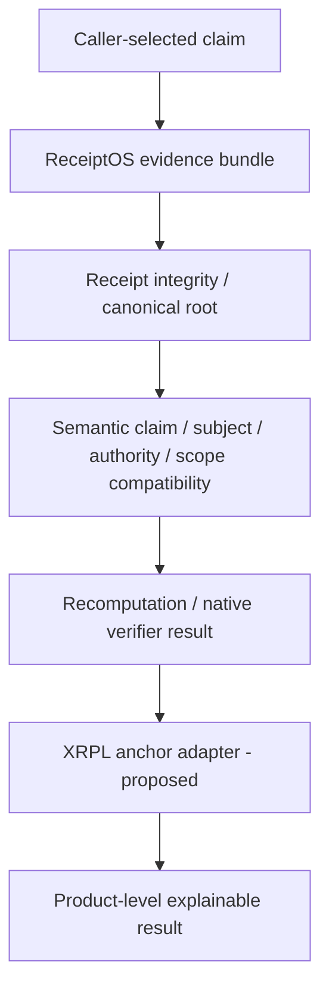

# ReceiptOS Verify x XRPL

## A Minimal Evidence-Anchoring Adapter Using Existing XRPL Primitives

Pavlo Tvardovskyi | Technical discussion note for Florian Alonso / XRPL Commons | 12 October 2026

## 1. Summary

XRPL can establish that a commitment was submitted under an account's authorization and included in a validated ledger. ReceiptOS Verify independently determines what the referenced evidence establishes for the caller-selected claim. **Ledger inclusion != semantic correctness. Valid anchor for claim A != proof of claim B.** [1,2]

The public v0.2.0 baseline checks bounded claim/evidence compatibility, integrity, authenticity, recomputation, sufficiency and requested guarantees, preserving native results. Its ledger boundary is interface-only; no live XRPL adapter exists. [9]

## 2. Why this boundary matters

Public Semantic ABI asks what one system's evidence is allowed to mean when consumed by another. ReceiptOS operationalizes that boundary with separate claim, subject/artifact, authority, scope, policy/version, time, assumptions, dependencies, evidence basis and replay checks. These are distinct projects; a digest does not replace their semantic relation. Current scope comparison is conservative equality, not arbitrary entailment. [9,10]

## 3. Minimal xrpl-receipt-anchor-v0

**CURRENT XRPL PRIMITIVES:** a standalone `AccountSet` with no account-setting options, authorized normally, carrying a Memo. V0 selects ordinary Sequence (no Ticket): it consumes a fee/sequence without changing account settings. [3,4]

**PROPOSED RECEIPTOS CONVENTION:** exactly one Memo: `MemoType = receiptos/xrpl-receipt-anchor-v0`; `MemoFormat = application/octet-stream`; `MemoData = R[32] || C[32]`. All three are hex-encoded for XRPL JSON. Type fixes layout/version; R is the supported SHA-256 receipt root, not a hash of arbitrary exported JSON. C commits to the complete declared claim surface, verification/root profiles and intended network/checkpoint. Subject stays in that preimage. No raw evidence or verdict goes on-ledger.

Crystal R excludes top-level anchor and is not whole-envelope identity; authenticated statement and payload/manifest closure must also pass.

Define `C = SHA256(domain || UTF8(JCS(preimage)))`, domain ASCII `receiptos.xrpl-receipt-anchor-v0.claim` followed by one NUL. JCS is RFC 8785: no duplicate keys, nonfinite numbers or invalid Unicode; no Unicode normalization; array order matters. Admission retains v0.2 safe-integer/schema bounds. This is a new anchor convention, not a claim that v0.2 already implements JCS. [8]

Decoded data is 64 bytes; type/format are 32/24 bytes. The entire binary-serialized Memos field must fit XRPL's 1 KB limit, including overhead. Reject malformed hex, wrong length and duplicate/extra Memos; unknown versions or delegated/sponsored/inner-Batch carriers are unsupported in v0. [3]

Compare exact Memo bytes to receipt-derived R/C, then bind actual transaction hash, caller-accepted submitting Account and validated ledger hash/index. Establish that the committed caller-trusted network/checkpoint is on that validated ledger history. Require `validated:true` **and** `meta.TransactionResult = tesSUCCESS`; a saved RPC flag alone is not proof. Transaction ID uses XRPL signed-binary hashing, not SHA-256 of RPC JSON. [1,2,5]

`NetworkID` is omitted for IDs <=1024 (Mainnet 0); required >=1025. Its absence is not Mainnet identity. Check the selected chain independently; IDs alone do not prevent every cross-chain replay. Master/regular-key/multisign account authorization does not establish the receipt issuer's business authority. [3,6]

## 4. Verification flow

Caller-selected claim -> evidence bundle -> receipt integrity/root -> claim/subject/authority/scope compatibility -> recomputation/native result -> XRPL anchor adapter -> explainable product result.

Proposed anchor-native states: `ANCHOR_MATCH`, `ANCHOR_MISMATCH`, `ANCHOR_NOT_ESTABLISHED`, `ANCHOR_MALFORMED`, `ANCHOR_UNSUPPORTED`. Preserve XRPL metadata separately. MATCH means the declared anchor relation holds under stated ledger trust; it never maps directly to global VERIFIED. Missing history/untrusted observation is NOT_ESTABLISHED, not proof of non-inclusion. [2]

## 5. Two concrete examples

Both examples assume independently established receipt integrity and a trusted, successful validated transaction anchoring receipt R and declaration A. They are synthetic contract examples, not ledger observations.

**A - matching claim:** receipt covers commit A; caller asks for A. Anchor = ANCHOR_MATCH; claim/subject = COMPATIBLE. Remaining layers continue; no global VERIFIED is inferred from the anchor.

**B - wrong claim:** same receipt and same valid anchor; caller asks for B. Anchor = ANCHOR_MATCH; integrity = VERIFIED; claim/subject = CONTRADICTED; overall = CONTRADICTED. The ledger anchor remains valid; transferring its support to B is invalid. This does not prove that B executed or failed.

## 6. DID / Credentials extension (optional)

DID can supply account-controlled document/verification-method references; XRPL does not validate that document's meaning. Credentials bind issuer account, subject account and issuer-defined CredentialType (1-64 bytes). A future policy must check subject acceptance, expiry and deletion/revocation at a selected ledger, plus accepted issuer/type. Neither establishes execution correctness; neither is mandatory for v0. Network amendment enablement must be checked before use. [7]

## 7. When would a new XRPL primitive be justified?

Consider a protocol primitive only after reproducing a needed relation that existing primitives cannot represent or verify without ambiguity, unsafe overloading or unacceptable off-ledger convention dependence. **POSSIBLE GAP - NOT YET ESTABLISHED:** typed claim/evidence commitments; explicit authority/subject relations; profile discoverability; stronger canonical semantics than Memo conventions. Implement and test the adapter first; derive any protocol discussion from a concrete failure. Existing primitives appear sufficient for the first bounded anchor.

## 8. Current limitations

This is an architecture proposal: no live transaction, codec conformance, portable consensus proof or deployment is demonstrated. Archive/validator trust and root-profile mapping need implementation tests. Anchoring proves no external execution, provider/hardware authenticity, evidence availability or arbitrary semantic entailment. Ledger inclusion time does not establish execution time.

ReceiptOS Verify is an independent experimental project by Pavlo Tvardovskyi. It uses or interoperates with public Trustless verification primitives where applicable. This adapter is not an official Trustless-AI or XRPL Commons integration, nor a protocol commitment by either organization.

## 9. References

[1] [Finality](https://xrpl.org/docs/concepts/transactions/finality-of-results); [2] [tx](https://xrpl.org/docs/references/http-websocket-apis/public-api-methods/transaction-methods/tx); [3] [Common fields / Memos / NetworkID](https://xrpl.org/docs/references/protocol/transactions/common-fields); [4] [AccountSet](https://xrpl.org/docs/references/protocol/transactions/types/accountset); [5] [Hashes](https://xrpl.org/docs/references/protocol/data-types/basic-data-types); [6] [Keys](https://xrpl.org/docs/concepts/accounts/cryptographic-keys); [7] [DID](https://xrpl.org/docs/concepts/decentralized-storage/decentralized-identifiers) / [Credentials](https://xrpl.org/docs/references/protocol/ledger-data/ledger-entry-types/credential); [8] [JCS](https://www.rfc-editor.org/rfc/rfc8785); [9] [v0.2.0](https://github.com/pipavlo82/receiptos-verify/releases/tag/v0.2.0); [10] [Semantic ABI](https://github.com/trustless-ai/semantic-abi). Accessed 2026-10-12 UTC; exact source pins and claim mapping: [REFERENCES.md](REFERENCES.md).
